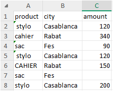
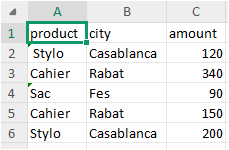

# Portfolio d'automatisation Excel
Projets Python pour automatiser des fichiers Excel : nettoyage, fusion et rapports.
## À propos
J'apprends Python pour automatiser les tâches Excel répétitives des petites entreprises.
Ce dépôt suit ma progression : chaque exercice est testé et vérifié.

Ce dépôt montre comment automatiser des rapports Excel : nettoyage des données, détection des anomalies et génération de rapports. Dans un cas réel, cela permet de réduire le temps de préparation d'un rapport mensuel de plusieurs heures à quelques minutes.

## Contenu
| Fichier | Description |
|---------|-------------|
| `day1.py` | Somme d'une liste avec une boucle `for` |
| `day2.py` | Somme de prix, puis somme des ventes supérieures à 100 avec `if` |
| `day3.py` | Lecture d'un fichier Excel avec pandas : somme et valeurs uniques |
| `day4.py` | Révision : lecture Excel, somme et produits uniques |
| `day5.py` | Filtrer (montant > 100) et trier les données avec pandas |
| `day6.py` | Nettoyer un fichier Excel : espaces, doublons, cellules vides |
| `day7.py` | Fusionner plusieurs fichiers Excel en un seul avec pandas |
| `day8.py` | Fusionner et nettoyer plusieurs fichiers Excel en un seul |
| `day9.py` | Rapport du total des ventes par produit |
| `day10.py` | Rapport du total des ventes par ville |
| `day11.py` | Mettre en forme un rapport Excel avec openpyxl : en-têtes en couleur et colonnes ajustées |
| `day12.py` | Projet final : fusionner, nettoyer et générer un rapport Excel formaté en 2 feuilles |
| `day13.py` | Rapport Excel formaté : ventes par produit et par ville |

## Avant / Après
Fichier Excel désordonné, puis fichier nettoyé avec `day6.py` :

## Rapport final

## Outils
- Python 3.11
- pandas et openpyxl (utilisés)

## Feuille de route
- [x] Lire un fichier Excel avec pandas
- [x] Filtrer et trier les données
- [x] Nettoyer les données (doublons, cellules vides, espaces)
- [x] Écrire un fichier Excel
- [x] Fusionner plusieurs fichiers Excel en un seul
- [x] Générer un rapport de ventes

## Exemple de message client
Message type accompagnant un rapport Excel : signaler les lignes à vérifier (produit vide, montant manquant) et confirmer les totaux.

## Contact
Disponible pour des petites missions d'automatisation Excel. Contactez-moi via GitHub.
